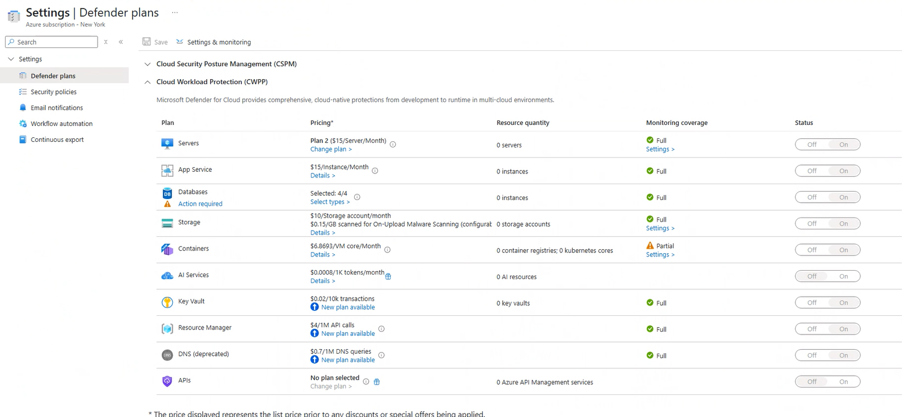

# ADVICE AND IMAGES

Dieses Dokument bündelt alle sicherheitsrelevanten Empfehlungen und technischen Hinweise zu den bereitgestellten ARM-Templates.  
Es beschreibt die zugrunde liegende Auswahl der verwendeten OS-Images sowie die wichtigsten Azure- und Defender-Empfehlungen, die nach der Bereitstellung von Windows- und Linux-VMs auftreten können.

- [**💽 Auswahl & Verwendung von Azure Standard-Images**](#-auswahl--verwendung-von-azure-standard-images)
- [**📘 Hinweise zur Security & Compliance im Azure Portal nach der Bereitstellung**](#-hinweise-zur-security--compliance-im-azure-portal-nach-der-bereitstellung)
- [**📑 Weitere Empfehlungen**](#-weitere-empfehlungen)

## 💽 Auswahl & Verwendung von Azure Standard-Images

Für die Bereitstellung virtueller Maschinen werden in den ARM-Templates ausschließlich **aktuelle Azure Marketplace Gen2 Standard-Images** verwendet.
Diese Images werden direkt von Microsoft bereitgestellt, regelmäßig aktualisiert und enthalten die jeweils neuesten Sicherheits- und Plattformfunktionen. Dadurch wird sichergestellt, dass Systeme immer auf einer geprüften Basis laufen.

Azure setzt standardmäßig auf Generation 2 (Gen2)-Images.
Diese basieren auf UEFI und unterstützen Secure Boot, vTPM und Trusted Launch - die Voraussetzung für moderne Sicherheitsmechanismen in Azure.
Generation 1 (Gen1)-Images sind nur noch für Legacy-Kompatibilität verfügbar und bieten keine Unterstützung für diese Sicherheitsfeatures.

### Sicherheitsrelevante Mindestanforderungen

| Feature                                        | Beschreibung                                          |
| ---------------------------------------------- | ------------------------------------------------------|
| **Secure Boot**                                | Validiert während des Systemstarts nur signierte Bootloader und Kernel-Komponenten. Schützt den Boot-Prozess vor Manipulationen (z. B. Rootkits, Bootkits) und stellt sicher, dass ausschließlich vertrauenswürdige Software geladen wird.|
| **vTPM**                                       | Stellt einen hardwarebasierten Vertrauensanker bereit. Unterstützt Verschlüsselung mit BitLocker, Measured Boot und Integritätsprüfungen. Voraussetzung für Trusted Launch. |
| **Trusted Launch**                             | Aktiviert eine manipulationssichere Startumgebung durch Kombination von Secure Boot und vTPM. Ermöglicht die Überwachung des Bootvorgangs und Integritätsberichte über Azure Defender for Cloud.                                                                                  |
| **Encryption at Host**                         | Verschlüsselt Daten bereits auf dem physischen Host, bevor sie auf den Datenträger geschrieben werden. Ergänzt die VM- und Disk-Verschlüsselung um eine zusätzliche Schutzebene gegen unbefugten Zugriff auf Infrastrukturebene. |
| **Azure Defender & Monitoring Kompatibilität** | Volle Unterstützung für **Microsoft Defender for Cloud**, **Azure Monitor**, **Azure Policy** und **Microsoft Sentinel**. Inklusive Kompatibilität der **Azure Monitor Agent (AMA)** und **Defender Agents** zur Erfassung von Security Events, Systemmetriken und Compliance-Daten. |

## 📘 Hinweise zur Security & Compliance im Azure Portal nach der Bereitstellung

> [!NOTE]
> Es kann bis zu 24 Stunden dauern, bis Compliance- und Sicherheitshinweise und Empfehlungen im Azure Portal angezeigt werden!

Folgende Hinweise und Empfehlungen werden nach der Bereitstellung der VM angezeigt und werden von den Templates nicht aufgelöst.

| **Type**  |  **Hinweis/Empfehlung**  | **Kurzbeschreibung**  |
|-----------|------------------|-----------------------|
| General      | [Azure Backup should be enabled for virtual machine](#azure-backup-should-be-enabled-for-virtual-machines) | VMs über einen Recovery Services Vault sichern |
| General      | [Only approved VM extensions should be installed](#only-approved-vm-extensions-should-be-installed) | Nur geprüfte und genehmigte Erweiterungen zulassen* |
| General      | [Audit flow logs configuration for every virtual network](#audit-flow-logs-configuration-for-every-virtual-network) | Netzwerk-Flow-Logs aktivieren, um Datenverkehr zu überwachen* |
| 🪟Windows   | [Windows Defender Exploit Guard should be enabled on machines](#windows-defender-exploit-guard-should-be-enabled-on-machines) | Exploit Guard aktivieren, um Angriffe proaktiv zu blockieren* |
| 🪟Windows   | [EDR configuration issues should be resolved on virtual machines](#edr-configuration-issues-should-be-resolved-on-virtual-machines) | EDR-Agent über Defender for Servers Plan 1 oder höher bereitstellen* |
| 🪟Windows   | [Guest Configuration extension should be installed on machines](#guest-configuration-extension-should-be-installed-on-machines) | Guest Configuration-Erweiterung für Policy-Compliance aktivieren* |
| 🐧Linux     | [Machines should have vulnerability findings resolved](#machines-should-have-vulnerability-findings-resolved) | Schwachstellen auf VMs regelmäßig prüfen und beheben |
| 🐧Linux     | [EDR solution should be installed on Virtual Machines](#edr-solution-should-be-installed-on-virtual-machines) | Endpoint Detection & Response-Agent installieren (z. B. Defender for Servers)|
| 🐧Linux     | [Guest Attestation extension should be installed on supported Linux virtual machines](#guest-attestation-extension-should-be-installed-on-supported-linux-virtual-machines) | Guest Attestation-Erweiterung aktivieren (TPM-/vTPM-Validierung)|

*Können durch Azure-Richtlinien (und der Verwendung des Azure Accelerators) automatisch und zentral angewandt werden!

Alle für virtuelle Maschinen relevanten Sicherheitsanforderungen – wie **Trusted Launch**, **Secure Boot**, **vTPM**, **Encryption at Host** und die Einhaltung der Microsoft-Sicherheitsrichtlinien – werden durch dieses Template aber berücksichtigt und automatisch umgesetzt.

### General  

---

### Azure Backup should be enabled for virtual machines

Für den Schutz vor Datenverlust sollte ein [Azure Backup](https://learn.microsoft.com/en-us/azure/backup/backup-overview) über einen Recovery Services Vault konfiguriert werden.
Dazu die VM einem vorhandenen oder neuen Vault zuweisen und eine passende Backup Policy auswählen.
Die Sicherung wird anschließend automatisch gemäß der Policy durchgeführt.
Nicht benötigte Systeme oder kurzfristige Test-VMs können in Defender for Cloud als ausgenommen (exempted) markiert werden.

### Only approved VM extensions should be installed

Die Richtlinie **„Only approved VM extensions should be installed“** stellt sicher, dass auf virtuellen Maschinen nur **freigegebene und geprüfte Erweiterungen** installiert werden.  
Dies betrifft auch die **standardmäßig von Azure bereitgestellten Extensions** (z. B. für Windows- oder Linux-Policies), sofern sie nicht bereits als *Approved* markiert wurden.  
Nicht genehmigte oder unbekannte Erweiterungen können potenzielle Sicherheitsrisiken darstellen und sollten daher überprüft oder ausgeschlossen werden.

> [!NOTE] Wenden Sie sich dafür bitte sich dafür an den zusätnigen IT-Sicherheitsbeauftragten Ihrer Firma.

In **Microsoft Defender for Cloud** können Erweiterungen, die bewusst eingesetzt und als sicher bewertet wurden, als **„Approved“** markiert werden.
Dadurch werden sie künftig **nicht mehr als Sicherheitsabweichung** gemeldet und gelten als freigegeben.

**Vorgehen:**

1. Im **[Azure-Portal](https://portal.azure.com)** anmelden.  
2. Im Azure-Portal zu „Policy“ navigieren.
3. Die Policy „**Only approved VM extensions should be installed**“ auswählen.
4. Die Policy für den richtigen Scope (Subscription/Resource Group) zuweisen.
5. Beim Parameter-Feld die Liste „**approvedExtensions**“ ausfüllen mit den Typen der Extensions, die erlaubt sind.

### Audit flow logs configuration for every virtual network

Für eine vollständige Überwachung des Netzwerkverkehrs sollten [NSG Flow Logs](https://learn.microsoft.com/en-us/azure/network-watcher/nsg-flow-logs-overview) aktiviert werden.
Dazu muss zunächst der Network Watcher in der jeweiligen Region aktiviert sein.
Anschließend die NSG Flow Logs auf den relevanten Network Security Groups (NSGs) aktivieren und die Protokolle an einen Storage Account oder Log Analytics Workspace senden.
Die Flow Logs ermöglichen eine detaillierte Analyse des ein- und ausgehenden Datenverkehrs und unterstützen bei der Erkennung verdächtiger Aktivitäten.

### 🪟 Windows spezifisch

---

### Windows Defender Exploit Guard should be enabled on machines

**Windows Defender Exploit Guard** ist Bestandteil von Microsoft Defender und schützt Windows-Systeme vor Exploits und verdächtigem Verhalten.  
Er ergänzt bestehende Sicherheitsmechanismen um eine präventive Schutzschicht (z. B. Attack Surface Reduction Rules, Controlled Folder Access, Network Protection).

**Empfohlene Umsetzung:**

1. **Zentrale Konfiguration über Intune (MDM) oder Gruppenrichtlinien (GPO)**
   - Einstellungen werden zentral verteilt.
   - Systeme erhalten eine einheitliche Konfiguration, kein manueller Aufwand auf einzelnen Servern.

2. **Verwendung der Microsoft Security Baselines**
   - Baselines dienen als Ausgangspunkt für die Konfiguration.
   - Wichtig: Baselines aktivieren Exploit Guard *nicht vollständig* → ASR-Regeln und weitere Einstellungen müssen zusätzlich gesetzt oder verschärft werden.

3. **Überwachung über Defender for Cloud**
   - Defender for Cloud überwacht den Compliance-Status der VMs.
   - Zeigt Systeme an, bei denen Exploit Guard nicht korrekt konfiguriert ist.
   - Defender for Cloud **aktiviert nichts**, er zeigt nur Abweichungen an.

### EDR configuration issues should be resolved on virtual machines

Für die Bereitstellung und automatische Registrierung des EDR-Agents ist mindestens [Defender for Servers Plan 1](#defender-for-servers-plan-1-oder-höher) erforderlich.
Der Microsoft Defender for Endpoint-Agent (EDR) wird bei aktivem Plan 1 auf unterstützten Betriebssystemen automatisch installiert und konfiguriert.

### Guest Configuration extension should be installed on machines

Die Richtlinie **„Guest Configuration extension should be installed on machines“** stellt sicher, dass die **Guest Configuration-Erweiterung** auf allen virtuellen Maschinen vorhanden ist.  
Diese Erweiterung ermöglicht es **Azure Policy**, Konfigurations- und Compliance-Prüfungen **innerhalb des Betriebssystems** durchzuführen – z. B. ob Sicherheitsrichtlinien, Benutzerrechte oder Systemkonfigurationen den Unternehmensstandards entsprechen.

In einer regulierten Azure Umgebung wird die Erweiterung **automatisch über Azure Policy** installiert.

### 🐧 Linux spezifisch

---

### Machines should have vulnerability findings resolved

Für die Erkennung von Schwachstellen ist ein [Vulnerability Assessment](https://learn.microsoft.com/en-us/azure/defender-for-cloud/auto-deploy-vulnerability-assessment)
-Tool erforderlich, das regelmäßig Sicherheitslücken auf der VM identifiziert.
In Defender for Servers Plan 1 oder 2 ist der Microsoft Defender Vulnerability Assessment Scanner bereits enthalten und kann über Defender for Cloud → Empfehlungen automatisch bereitgestellt werden.
Gefundene Schwachstellen sollten zeitnah bewertet und behoben werden, um unbefugten Zugriff, Datenverlust oder Systemausfälle zu verhindern.
Nicht relevante Systeme (z. B. Test- oder isolierte Umgebungen) können in Defender for Cloud als ausgenommen (exempted) markiert werden.

Es ist mindestens [Defender for Servers Plan 1](https://learn.microsoft.com/en-us/azure/defender-for-cloud/defender-for-servers-overview#plan-protection-features) erforderlich.

### EDR solution should be installed on Virtual Machines

Für die Bereitstellung und automatische Registrierung des EDR-Agents ist mindestens [Defender for Servers Plan 1](#defender-for-servers-plan-1-oder-höher) erforderlich.
Der Microsoft Defender for Endpoint-Agent (EDR) wird bei aktivem Plan 1 auf unterstützten Betriebssystemen automatisch installiert und konfiguriert.

### Guest Attestation extension should be installed on supported Linux virtual machines

Für die Überprüfung der Boot-Integrität ist die Installation der Guest Attestation Extension erforderlich.
Diese wird nicht automatisch auf Linux-VMs installiert und muss über Microsoft Defender for Cloud aktiviert werden.
Die automatische Bereitstellung erfolgt, wenn in den Defender for Cloud Einstellungen unter
Defender-Pläne → Servers → Settings → Auto-Provisioning
die Option „Enable Guest Attestation extension on supported Linux machines“ aktiviert ist.
Nur Trusted Launch- oder Confidential Linux-VMs unterstützen diese Erweiterung; andere Systeme können in Defender for Cloud entsprechend ausgenommen (exempted) werden.

Es ist mindestens [Defender for Servers Plan 1](https://learn.microsoft.com/en-us/azure/defender-for-cloud/defender-for-servers-overview#plan-protection-features) erforderlich.

---

## 📑 Weitere Empfehlungen

### Defender for Servers Plan 1 oder höher

Für den vollständigen Schutz und die Umsetzung aller sicherheitsrelevanten Empfehlungen wird mindestens **Microsoft Defender for Servers Plan 1** empfohlen.  
Dieser Plan stellt sicher, dass alle sicherheitsbezogenen **Azure Policy-Überprüfungen** und **Defender for Cloud-Bewertungen** korrekt ausgeführt werden.  
In **regulierten oder bereits vorkonfigurierten Azure-Umgebungen** ist Defender for Servers in der Regel **vorausgesetzt** oder **standardmäßig integriert**, um die Einhaltung von Compliance- und Sicherheitsrichtlinien sicherzustellen.

#### **Kurz-Anleitung: Defender for Servers aktivieren**

1. Im **[Azure-Portal](https://portal.azure.com)** anmelden (Benutzerrolle: Owner/Contributor oder Security Admin).  
2. Oben in der Suchleiste **„Defender for Cloud“** suchen und öffnen.  
3. In Defender for Cloud zu **Environment settings** (oder **Pricing & settings**) navigieren.  
4. Die gewünschte **Subscription** auswählen.  
5. Unter **Defender plans / Pricing & settings** die Option **„Defender for Servers“** aktivieren und **Plan 1 (oder höher)** auswählen.  
6. Falls erforderlich, einen **Log Analytics Workspace** auswählen oder neu anlegen — dieser wird für Telemetrie, Alerts und automatische Erkennung benötigt.  
7. **Auto-Provisioning** für den Agenten (Log Analytics Agent / Azure Monitor Agent) aktivieren, damit vorhandene und neue VMs automatisch onboarded werden.  
8. Änderungen speichern und die Onboarding-Jobs überwachen (Onboarding kann einige Minuten dauern).

---
